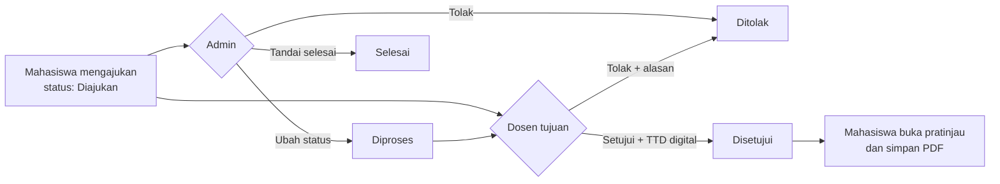

# SIPAS — Sistem Informasi Pengajuan Surat & Verifikasi Tanda Tangan Dosen

Aplikasi desktop untuk layanan surat jurusan **Sistem Informasi, Universitas Tadulako**. Mahasiswa mengajukan surat, admin mengelola data dan pengajuan, dan dosen menyetujui surat dengan **tanda tangan digital** sehingga mahasiswa tidak perlu mencetak surat dan menghadap dosen.

> Proyek praktikum Rekayasa Perangkat Lunak (UTS) — Kelompok 4, Kelas C, S1 Sistem Informasi.

---

## Daftar Isi

1. [Fitur](#fitur)
2. [Teknologi](#teknologi)
3. [Arsitektur dan Struktur Proyek](#arsitektur-dan-struktur-proyek)
4. [Alur Kerja dan Status Pengajuan](#alur-kerja-dan-status-pengajuan)
5. [Basis Data](#basis-data)
6. [Instalasi dan Menjalankan](#instalasi-dan-menjalankan)
7. [Akun Contoh](#akun-contoh)
8. [Tanda Tangan Digital](#tanda-tangan-digital)
9. [Pengujian dan CI](#pengujian-dan-ci)
10. [Build Executable](#build-executable)
11. [Catatan, Batasan, dan Pekerjaan Lanjutan](#catatan-batasan-dan-pekerjaan-lanjutan)

---

## Fitur

Aplikasi memiliki tiga peran. Menu sidebar mengikuti peran yang login.

| Peran | Menu | Fungsi utama |
|---|---|---|
| **Mahasiswa** | Ringkasan, Buat Pengajuan, Status Pengajuan | Memilih jenis surat dan dosen tujuan, mengisi keperluan, melampirkan berkas (maks. 5 MB), memantau status, membuka pratinjau surat dan menyimpannya sebagai PDF |
| **Admin** | Dashboard Admin, Kelola Pengajuan, Data Mahasiswa, Data Dosen, Jenis Surat | Melihat semua pengajuan, mengubah status, menginput pengajuan atas nama mahasiswa, CRUD mahasiswa/dosen/jenis surat |
| **Dosen** | Dashboard Dosen, Surat Masuk & TTD, Riwayat TTD Digital, Profil & Speciment TTD | Meninjau surat masuk, menyetujui dan menandatangani secara digital, menolak dengan alasan, mengunggah gambar tanda tangan |

Fitur lain: pencarian dan filter status di semua daftar, pratinjau surat resmi, ekspor PDF (ReportLab), splash screen, dan tema antarmuka seragam.

## Teknologi

| Komponen | Teknologi |
|---|---|
| Bahasa | Python 3.11 (versi di CI) |
| Antarmuka | Tkinter / ttk (tema `clam`) |
| Basis data | MySQL 8.x (dump dibuat dengan MySQL 8.4.3) lewat `mysql-connector-python` |
| PDF | ReportLab |
| Gambar | Pillow |
| Pengujian | pytest, pytest-cov, flake8 |
| Distribusi | PyInstaller |

## Arsitektur dan Struktur Proyek

Pola **MVC**. View tidak mengakses basis data langsung; semua akses data lewat Controller lalu Model.

```
SIPAS-Main/
├── main.py                    # Jendela utama, sidebar per peran, navigasi
├── splash_sipas.py            # Splash screen
├── migrate_dosen.py           # Skrip migrasi lama (lihat Catatan — jangan dijalankan apa adanya)
├── requirements.txt
├── pytest.ini
├── app.ico, screen.png        # Ikon dan logo
├── config/
│   └── database.py            # Koneksi MySQL (Database.get_connection)
├── models/                    # Akses data (SQL)
│   ├── auth_model.py          # Login admin / dosen / mahasiswa
│   ├── admin_model.py
│   ├── dosen_model.py         # CRUD dosen, simpan file TTD
│   ├── mahasiswa_model.py
│   ├── jenis_surat_model.py
│   └── pengajuan_surat_model.py   # Query pengajuan, approve/tolak dosen, lampiran
├── controllers/               # Validasi dan logika aplikasi
│   ├── auth_controller.py
│   ├── mahasiswa_controller.py
│   ├── admin_controller.py
│   └── dosen_controller.py
├── views/                     # Tkinter
│   ├── login_view.py
│   ├── dashboard_view.py      # Ringkasan mahasiswa
│   ├── pengajuan_view.py      # Form pengajuan
│   ├── status_view.py         # Status pengajuan mahasiswa
│   ├── admin_view.py          # Seluruh halaman admin
│   ├── dosen_view.py          # Seluruh halaman dosen
│   ├── surat_preview_dialog.py # Pratinjau surat + ekspor PDF
│   ├── image_loader.py, theme.py
├── storage/
│   ├── lampiran/              # Lampiran pengajuan
│   └── ttd_dosen/             # Gambar tanda tangan dosen (ttd_dosen_<id>.<ext>)
├── database/
│   └── db_pengajuan_surat.sql # Dump basis data (skema + data contoh)
├── tests/                     # test_auth.py, test_pengajuan.py
└── .github/workflows/ci_pipeline.yml
```

## Alur Kerja dan Status Pengajuan



Nilai status yang dipakai aplikasi: `Diajukan`, `Diproses`, `Disetujui`, `Selesai`, `Ditolak`.

- Pengajuan baru otomatis berstatus `Diajukan`.
- **Admin** mengubah status lewat halaman Kelola Pengajuan (dicatat di `id_admin`, `tanggal_verifikasi_admin`).
- **Dosen** melihat pengajuan yang ditujukan kepadanya **atau** yang belum punya dosen (`id_dosen IS NULL`). Keputusan dosen dicatat di `id_dosen`, `catatan_dosen`, `tanggal_keputusan_dosen`.
- Dosen **tidak dapat menyetujui** sebelum mengunggah specimen tanda tangan (gambar) di menu *Profil & Speciment TTD*.
- Penolakan dosen mewajibkan alasan.

## Basis Data

Nama basis data: `db_pengajuan_surat`. Enam tabel:

| Tabel | Isi | Relasi penting |
|---|---|---|
| `admin` | Akun admin (`username`, `password`, `nama_admin`) | — |
| `dosen` | Akun dan profil dosen (`username`, `password_hash`, `nidn`, `jabatan`, `email`, `file_ttd`, `status`) | `jabatan`: Dosen Wali, Dosen Pembimbing, Ketua Program Studi, Ketua Jurusan |
| `mahasiswa` | Akun dan profil (`nim`, `username`, `password_hash`, `nama`, `prodi`, `email`) | — |
| `jenis_surat` | Kategori surat (`jenis_surat`, `aktif`) | 1 → N `detail_surat`, `pengajuan` |
| `detail_surat` | Nama dan deskripsi surat per kategori | FK ke `jenis_surat` |
| `pengajuan` | Transaksi pengajuan, status, catatan admin/dosen | FK ke `mahasiswa`, `jenis_surat`, `detail_surat`, `admin`, `dosen` |
| `dokumen_surat` | Berkas terkait pengajuan: nama/path file, `hash_sha256`, penandatangan, waktu tanda tangan | 1:1 ke `pengajuan` (`UNIQUE id_pengajuan`), FK `ditandatangani_oleh` → `dosen` |

Relasi inti:

```
mahasiswa 1──N pengajuan N──1 jenis_surat 1──N detail_surat
admin     1──N pengajuan (verifikator, opsional)
dosen     1──N pengajuan (penyetuju, opsional)
pengajuan 1──1 dokumen_surat ──N..1 dosen (penandatangan)
```

Kategori surat awal (tabel `jenis_surat`) dan contoh `detail_surat`:

| Kategori | Contoh surat |
|---|---|
| Status Akademik & Perkuliahan | Cuti Akademik; Aktif Kuliah Kembali |
| Penelitian & Kegiatan Lapangan | Izin Penelitian; Izin Magang/PKL |
| Tugas Akhir | Seminar Proposal; Ujian Hasil/Sidang Akhir |
| Administrasi & Keuangan | Keterangan Aktif Kuliah; Keringanan/Penundaan UKT |

## Instalasi dan Menjalankan

### Prasyarat

- Python 3.11 atau lebih baru (dengan Tkinter; sudah termasuk di installer Python resmi Windows/macOS)
- MySQL Server 8.x berjalan di `localhost:3306` (mis. lewat Laragon atau XAMPP)

### Langkah

1. **Salin proyek dan siapkan virtual environment**

   ```bash
   cd SIPAS-Main
   python -m venv env
   # Windows:  env\Scripts\activate
   # macOS/Linux: source env/bin/activate
   pip install -r requirements.txt
   ```

2. **Buat basis data dan impor dump**

   ```bash
   mysql -u root -e "CREATE DATABASE IF NOT EXISTS db_pengajuan_surat CHARACTER SET utf8mb4;"
   mysql -u root db_pengajuan_surat < database/db_pengajuan_surat.sql
   ```

3. **Sesuaikan koneksi** di `config/database.py` (bawaan: host `localhost`, user `root`, password kosong, database `db_pengajuan_surat`).

4. **Jalankan aplikasi**

   ```bash
   python main.py
   ```

   Jalankan dari folder `SIPAS-Main/` agar folder `storage/` terbaca (path disimpan relatif).

## Akun Contoh

Dump SQL (`database/`) memuat akun dan data pengajuan contoh, termasuk dosen `yuda123` dan `sinan123` yang sudah memiliki gambar tanda tangan di `storage/ttd_dosen/`. Login memakai **username** (atau NIM untuk mahasiswa, username/NIDN untuk dosen).

| Peran | Username contoh |
|---|---|
| Admin | `Admin SI` |
| Dosen | `yuda123` (Ketua Jurusan), `trian123` (Ketua Program Studi), `widyo123` (Dosen Pembimbing), `sinan123` (Dosen Wali) |
| Mahasiswa | `rusfaldi123`, `rizky123`, `raihan123`, `nabil123`, `mulya123`, `akbar123` |

Kata sandi awal ada pada dump SQL dan kode (kata sandi admin tersimpan polos di dump). Akun baru yang dibuat admin memakai kata sandi bawaan: **NIM** untuk mahasiswa dan `dosen123` untuk dosen. **Ganti semua kata sandi ini sebelum aplikasi dipakai di luar demo.**

## Tanda Tangan Digital

Alur pada versi saat ini:

1. Dosen mengunggah gambar tanda tangan di *Profil & Speciment TTD*. Berkas disalin ke `storage/ttd_dosen/ttd_dosen_<id_dosen>.<ext>` dan path-nya disimpan di `dosen.file_ttd`.
2. Pada *Surat Masuk & TTD*, dosen memilih pengajuan, melihat pratinjau, lalu menekan setujui (catatan opsional).
3. `PengajuanSuratModel.approve_dosen` dalam satu transaksi (kolom `ditandatangani_oleh` dan `waktu_tanda_tangan` kini boleh NULL sehingga lampiran bisa disimpan sebelum persetujuan): mengubah status menjadi `Disetujui`, mengisi `id_dosen`, `catatan_dosen`, `tanggal_keputusan_dosen`, lalu menyimpan/memperbarui baris `dokumen_surat` berisi kode `hash_sha256`, penandatangan, dan waktu.
4. Mahasiswa membuka *Status Pengajuan* → pratinjau surat → **Simpan PDF**. PDF dibuat ReportLab (A4) dan memuat gambar tanda tangan dosen, nama, jabatan, NIDN, serta kode SHA-256.

Perlu dipahami batas implementasinya (detail di bagian berikut): kode SHA-256 saat ini adalah **pengenal unik** yang dibentuk dari ID pengajuan, ID dosen, dan waktu, bukan hash dari isi PDF, dan pola "QR" pada pratinjau bersifat visual (tidak dapat dipindai).

## Pengujian dan CI

```bash
python -m pytest -v          # menjalankan semua tes
python -m pytest --cov=.     # dengan cakupan
flake8 models/ controllers/ --count --select=E9,F63,F7,F82 --show-source --statistics
```

`tests/` berisi 9 tes (autentikasi, validasi pengajuan, statistik dosen, hash approve, tolak dosen, ubah status admin) yang memakai `MagicMock`.

Pada pengecekan terakhir tanpa MySQL aktif: **7 lulus, 2 gagal** — `test_login_mahasiswa_berhasil_mock` dan `test_approve_dosen_menghasilkan_hash_sha256`, karena keduanya masih memanggil `Database.get_connection()` (mock tidak menggantikan koneksi sebenarnya). Dengan MySQL lokal dan basis data terisi, hasilnya dapat berbeda.

Pipeline GitHub Actions (`.github/workflows/ci_pipeline.yml`) berjalan pada push dan pull request ke `main`: checkout, Python 3.11, `pip install -r requirements.txt`, flake8 (kesalahan fatal saja), lalu pytest. Karena runner tidak memiliki layanan MySQL, dua tes di atas akan gagal di CI sampai diperbaiki.

## Build Executable

```bash
pyinstaller SIPAS.spec
```

Hasil: `dist/SIPAS/` (dan `SIPAS.app` di macOS). Spesifikasi saat ini `datas=[]`, jadi `app.ico` dan gambar lain tidak ikut dibundel; tambahkan ke `datas` bila ikon/logo tidak tampil pada hasil build. Executable tetap membutuhkan MySQL yang dapat dijangkau dan folder `storage/` di direktori kerjanya.

## Catatan, Batasan, dan Pekerjaan Lanjutan

Daftar ini jujur tentang kondisi kode saat ini, agar mudah dijadikan backlog.

**Keamanan**
- Kata sandi admin disimpan dan dibandingkan sebagai **teks polos** (`admin.password`).
- Kata sandi dosen dan mahasiswa memakai SHA-256 **tanpa salt**; disarankan bcrypt atau argon2.
- Kredensial basis data tertanam di `config/database.py`; pindahkan ke variabel lingkungan atau berkas konfigurasi lokal.
- Berkas dump berisi data dan akun contoh; jangan dipakai apa adanya di lingkungan produksi.

**Tanda tangan digital**
- Kode SHA-256 pada `approve_dosen` dibentuk dari `id_pengajuan`, `id_dosen`, dan waktu, sehingga tidak dapat dipakai membuktikan keaslian isi dokumen. Pengembangan: hitung SHA-256 dari berkas PDF final dan simpan.
- Belum ada halaman verifikasi keaslian dan QR yang dapat dipindai.
- PDF dibuat saat menekan *Simpan PDF*; `dokumen_surat.path_file` mencatat `storage/surat/...`, namun berkas tersebut tidak dibuat otomatis oleh `approve_dosen`.
- Penomoran surat resmi belum ada; `nomor_pengajuan` hanyalah `id_pengajuan` berpad nol.
- Tanda tangan berupa gambar plus kode; keabsahan hukumnya untuk keperluan eksternal bergantung pada kebijakan kampus.

**Basis data dan kode**
- Dump SQL tidak membuat basis datanya; buat `db_pengajuan_surat` lebih dulu (langkah instalasi 2).
- `migrate_dosen.py` adalah skrip lama dengan skema `dosen` yang berbeda (`nip`, `tanda_tangan_digital`) dan menjalankan `DROP TABLE dosen`. **Jangan dijalankan** pada basis data yang sudah diimpor dari dump.
- Lampiran dan dokumen bertanda tangan berbagi satu baris `dokumen_surat` per pengajuan (`UNIQUE id_pengajuan`); menyetujui pengajuan yang punya lampiran menimpa `path_file`/`nama_file` lampiran. Pertimbangkan memisahkannya.
- Belum ada tabel riwayat status; hanya status terkini yang tersimpan.
- Admin dapat mengubah status ke nilai apa pun tanpa aturan transisi.
- Koneksi dibuka dan ditutup per query (tanpa connection pool).

**Pengujian**
- Perbaiki dua tes yang butuh koneksi nyata (mock `Database.get_connection`), atau sediakan layanan MySQL di workflow CI.
- Tes baru yang disarankan: transisi status, hak akses dosen (hanya pengajuan miliknya), dan validasi lampiran.

## Tim

| Nama | Peran |
|---|---|
| Raihan Irbah Zaki | Ketua / Project Manager & System Analyst |
| Muh Akbar Khadapi Dape | Process Designer |
| Muhammad Rizky Al Ghifari | UML Designer |
| Rusfaldi Andika | Database Designer |
| Nabil Afzaal | System Architect / Programmer |
| Mulya Syaputra Jufran | Database Designer & UI/UX Designer |